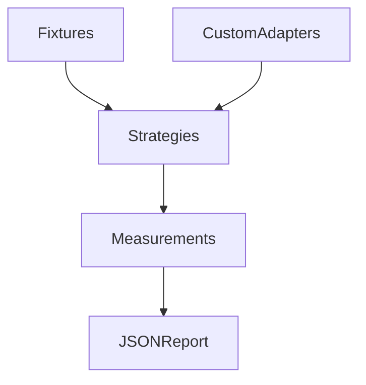

<div align="center">

# Agent Strategy Eval

Formerly **FlowEval**. Repository branding has changed; Python package names, imports and CLI commands remain compatible.

**Compare memory strategies with reproducible fixtures.**

[](https://www.python.org/) [](LICENSE) [](docs/architecture.md) [](https://github.com/Elyon0517/agent-strategy-eval/stargazers)

Find this useful? Give it a star ⭐

[English](README.md) · [简体中文](README.zh-CN.md) · [Architecture](docs/architecture.md) · [Examples](examples) · [Validation](docs/validation.md)

</div>



## Purpose

An independent evaluation harness for memory/context strategies. Replace the five offline baselines with real application callbacks. Synthetic fixture pass rates are not claims about real model task success.

## Install and try

```bash
pip install "floweval-memory @ git+https://github.com/Elyon0517/agent-strategy-eval.git@v0.1.0"
```

```python
from floweval import Case, evaluate, report
from floweval.strategies import BASELINES

case = Case(
    "diet",
    "Plan dinner",
    memories=("Vegetarian dinner",),
    profile=("Vegetarian meals",),
    expected=("vegetarian",),
)
print(report(evaluate((case,), BASELINES))["strategies"])
```

## Capabilities

- Five transparent baselines: no memory, short-term, summary, retrieval and personalized memory.
- User-defined strategy callbacks; no dependency on either sibling repository.
- Expected phrase coverage, forbidden phrase hits, fixture pass rate and strategy errors.
- Output character count, optional caller-supplied token count and measured strategy latency.
- JSON fixture input and machine-readable CLI reports.

## Scope and limitations

Bundled baselines select context; they do not call an LLM. Case-insensitive substring checks evaluate synthetic fixture requirements, not semantic task success or research-proven personalization. Query text is part of baseline output and can satisfy a check, so expected phrases should describe information absent from the query. Lexical retrieval is a baseline, not vector retrieval. Latency covers strategy execution only, not scoring or model latency unless your callback includes it. Token counts are absent unless you supply a tokenizer; characters are not tokens. No monetary cost is inferred. There is no sandbox for custom callbacks.

## Development

```bash
python -m venv .venv
source .venv/bin/activate
pip install -e '.[dev]'
pytest -q
ruff check .
mypy
floweval examples/fixtures.json --output report.json
```

## License

Licensed under the [MIT License](LICENSE).

Copyright © 2026 Honghao Li.

## Optional integration

[contextkit_comparison.py](examples/contextkit_comparison.py) compares a no-memory callback with real Agent Context Builder assembly. Install Agent Context Builder 0.2 separately before running it. The result checks fixture text in context; it is not a model task-success result.
