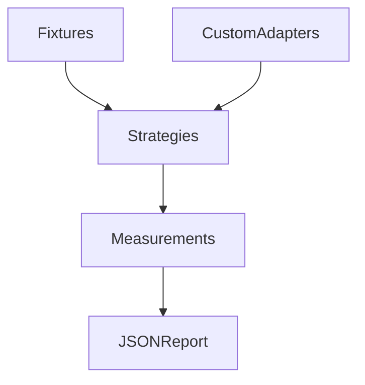

<div align="center">

# Agent Strategy Eval

原名 **FlowEval**。本次调整仓库名称；Python 包名、import 路径和 CLI 命令保持兼容。

**Compare memory strategies with reproducible fixtures.**

[](https://www.python.org/) [](LICENSE) [](docs/architecture.md) [](https://github.com/Elyon0517/agent-strategy-eval/stargazers)

喜欢这个项目？请点一个 Star ⭐

[English](README.md) · [简体中文](README.zh-CN.md) · [Architecture](docs/architecture.md) · [Examples](examples) · [Validation](docs/validation.md)

</div>



## 定位

独立的 memory/context 策略评测工具。内置五种离线基线，允许替换为真实应用回调。合成场景的通过率不代表真实模型的任务成功率。

## 安装与示例

```bash
pip install "floweval-memory @ git+https://github.com/Elyon0517/agent-strategy-eval.git@v0.1.0"
```

```python
from floweval import Case, evaluate, report
from floweval.strategies import BASELINES

case = Case(
    "diet",
    "Plan dinner",
    memories=("Vegetarian dinner",),
    profile=("Vegetarian meals",),
    expected=("vegetarian",),
)
print(report(evaluate((case,), BASELINES))["strategies"])
```

## 当前能力

- 比较无记忆、短期记忆、摘要、检索和个性化五种基线。
- 检查预期短语覆盖、禁止短语命中、合成场景通过率和策略异常。
- 记录输出字符数、可选 token 数与策略执行延迟。
- 支持自定义策略、JSON 输入和 CLI 报告。

## 边界与限制

内置基线仅选择上下文，不调用模型。短语匹配不是语义任务评分；query 本身包含预期答案可能导致通过，因此预期短语应来自 query 之外的信息。检索采用词汇交集。延迟只测策略执行；字符数不等于 token 数，也不推算费用。自定义回调由调用方负责，工具不提供沙箱。

## Development

```bash
python -m venv .venv
source .venv/bin/activate
pip install -e '.[dev]'
pytest -q
ruff check .
mypy
floweval examples/fixtures.json --output report.json
```

## License

[MIT](LICENSE) © Elyon Li

## 可选集成示例

[contextkit_comparison.py](examples/contextkit_comparison.py) 比较无记忆回调和真实 Agent Context Builder 上下文组装。运行前单独安装 Agent Context Builder 0.2。结果仅验证上下文中的合成短语，不代表模型任务成功率。
